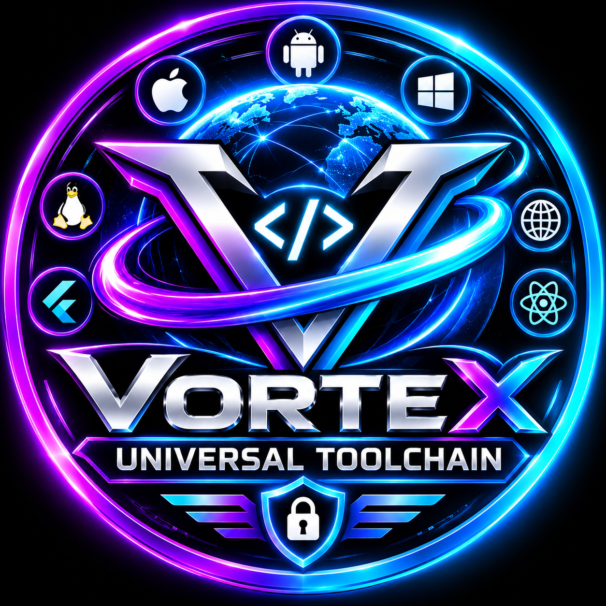

<p align="center">
  
</p>

# VORTEX UNIVERSAL TOOLCHAIN 🌀

> **ভাষা, কম্পাইলার, VIR, VM, WASM backend, AI engine, package manager,
> debugger, formatter, linter, test runner — সব নিজের।**
> একটিও third-party crate নেই — পুরো টুলচেইন ১০০% Rust std দিয়ে শূন্য থেকে বানানো।

**বর্তমান সংস্করণ: v0.2.0 — Expansion Release (৮টি সাবসিস্টেম কাজ করছে ✅)**

---

## ⚡ এই মুহূর্তে যা কাজ করে

| সাবসিস্টেম | বিবরণ | অবস্থা |
|---|---|---|
| **ভাষা VORTEX** | English + অসমীয়া + বাংলা keyword, ভারতীয় অংক (`৪২`) | ✅ |
| **Array & Map** | literal, index (ঋণাত্মক সহ), assign, insertion-order map | ✅ |
| **নিজস্ব Compiler → VIR** | stack bytecode + `.vxc` artifact | ✅ |
| **নিজস্ব VM** | call frames, step-machine API, 10k depth | ✅ |
| **নিজস্ব WASM backend** | AST → WebAssembly binary — হাতে লেখা encoder, LLVM ছাড়া | ✅ Node.js-এ যাচাইকৃত |
| **AI Engine** | অসমীয়া/বাংলা/English বাক্য → কোড + `explain` — কোনো API নেই | ✅ |
| **Package Manager** | নিজস্ব `.vpa` archive + নিজস্ব CRC32 + topo-sort resolver | ✅ |
| **Debugger** | VIR-level step/breakpoint/stack/locals | ✅ |
| **Formatter / Linter / Test runner** | `fmt` `lint` (L001–L006) `test` | ✅ |
| **CLI** | run ir ast tokens build exec repl keywords wasm ai explain pkg debug fmt lint test | ✅ |
| **টেস্ট** | ৬৪টি টেস্ট + GitHub Actions CI | ✅ |

দরকার শুধু Rust (edition 2021)। অন্য কিছু নয়।

## 🚀 Build ও Run

```bash
cargo build --release
cargo run --release -- run examples/hello.vx
```

সব শক্তি একবারে দেখতে:

```bash
cargo run --release -- run examples/data_structures.vx    # array+map+for-in+methods
cargo run --release -- ai "১ থেকে ১০ পর্যন্ত যোগফল দেখাও" --run
cargo run --release -- wasm examples/data_structures.vx    # নিজস্ব WebAssembly!
cargo run --release -- test tests/sample.vx                # (sample ফাইলে test_* থাকলে)
```

## 🌐 তিন ভাষায় একই ভাষা — এটাই VORTEX-এর পরিচয়

**English keywords** (`examples/hello.vx`):

```vortex
show("Hello, VORTEX!");
show("নমস্কাৰ, পৃথিৱী!");
```

**অসমীয়া keywords** (`examples/assamese_hello.vx`):

```vortex
ধৰো নাম = "অসম";
ধৰো বয়স = 50;

যদি (বয়স >= 18) {
    দেখুৱাওক(নাম + " — ভোট দিব পাৰে");
} নহলে {
    দেখুৱাওক("সৰু ছাত্র");
}

লুপ i ভিতৰত 1..4 {
    দেখুৱাওক("ঘূৰণ " + i);
}
```

**বাংলা keywords** (`examples/bengali_demo.vx`):

```vortex
ধরো দাম = 250;
ধরো সংখ্যা = 4;
ধরো মোট = দাম * সংখ্যা;

যদি (মোট > 900) {
    দেখাও("মোট: " + মোট + " — বেশি!");
} নাহলে {
    দেখাও("মোট: " + মোট);
}
```

## 📖 ভাষার ঝলক (v0.2)

```vortex
// Array — ঋণাত্মক index সহ
let a = [১০, ২০, ৩০];
push(a, ৪০);
show(a[0] + a[-1]);          // 50

// Map — insertion-order
let m = {"নাম": "ৰাম", "বয়স": ২৫};
m["শহৰ"] = "গুৱাহাটী";
show(m["নাম"]);              // ৰাম
show(keys(m));               // [নাম, বয়স, শহৰ]

// for-in — array/string/map সব জায়গায়
for x in a {
    if x == ২০ { continue; }
    if x > ৩৫ { break; }
    show(x);
}
for c in "অসমীয়া" { show(c); }

// String methods
show("hello".upper());           // HELLO
show("a,b,c".split(","));        // [a, b, c]
show("নমস্কাৰ".sub(0, 3));       // নমস

// গণিত
show(pow(2, ১০));                // 1024
```

## 🌍 নিজস্ব WebAssembly backend

`vortexc wasm file.vx` — হাতে লেখা binary encoder দিয়ে `.wasm` বানায়
(LLVM/binaryen কিছুই নেই)। Node.js-এ চালানো:

```bash
cargo run --release -- wasm examples/data_structures.vx
node -e "WebAssembly.instantiate(require('fs').readFileSync('examples/data_structures.wasm'),{})
  .then(async ({instance}) => {
    instance.exports.vortex_main();
    const p = Number(instance.exports.vortex_output());
    const m = new DataView(instance.exports.memory.buffer);
    const len = m.getInt32(p, true);
    console.log(new TextDecoder().decode(new Uint8Array(instance.exports.memory.buffer, p+8, len)));
  });"
```

বিস্তারিত: [`docs/WASM.md`](docs/WASM.md) • নিজস্ব playground:
[`playground/index.html`](playground/index.html)

## 🤖 AI Engine (নিজস্ব, কোনো API নেই)

```bash
cargo run --release -- ai "১ থেকে ১০ পর্যন্ত যোগফল দেখাও" --run
cargo run --release -- ai "৭ এর নামতা" --run
cargo run --release -- explain examples/loops.vx
```

বাক্যের লিপি চিনে সেই ভাষাতেই কোড বানায়। বিস্তারিত: [`docs/AI.md`](docs/AI.md)

## 📦 Package Manager (vpm)

```bash
vortexc pkg init mypkg && vortexc pkg build && vortexc pkg pack
vortexc pkg install mypkg-0.1.0.vpa && vortexc pkg list && vortexc pkg tree
```

নিজস্ব archive ফরম্যাট `.vpa` + নিজস্ব CRC32। বিস্তারিত:
[`docs/PACKAGE_MANAGER.md`](docs/PACKAGE_MANAGER.md)

## 🛠️ টুলচেইন

```bash
vortexc debug file.vx   # step/breakpoint/stack/locals
vortexc fmt file.vx -w  # formatter (idempotent)
vortexc lint file.vx    # L001–L006
vortexc test file.vx    # test_* ফাংশন + assert
```

বিস্তারিত: [`docs/TOOLS.md`](docs/TOOLS.md)

## 📚 ডকুমেন্টেশন

- [`docs/SPEC.md`](docs/SPEC.md) — ভাষার পূর্ণ স্পেসিফিকেশন + ব্যাকরণ
- [`docs/VIR.md`](docs/VIR.md) — bytecode instruction set
- [`docs/WASM.md`](docs/WASM.md) — নিজস্ব WASM backend-এর ডিজাইন
- [`docs/AI.md`](docs/AI.md) — AI engine
- [`docs/PACKAGE_MANAGER.md`](docs/PACKAGE_MANAGER.md) — vpm
- [`docs/TOOLS.md`](docs/TOOLS.md) — debugger/formatter/linter/test
- [`docs/ROADMAP.md`](docs/ROADMAP.md) — ৩২ ক্যাটাগরির মাস্টার প্ল্যান
- [`CHANGELOG.md`](CHANGELOG.md)

## 🧪 টেস্ট

```bash
cargo test --release   # ৬৪টি টেস্ট — lexer/parser/compiler/VM/AI/pkg/wasm/tools
```

## 🗺️ পরের ধাপ

Phase 1-এর বাকি ভাষা-বৈশিষ্ট্য (structs/classes, generics, pattern matching),
native backend (x86-64/ARM64 — Phase 3), নিজস্ব UI render engine + game
engine (Phase 4), AI-র neural স্তর + নিজস্ব cloud (Phase 5) — পূর্ণ
পরিকল্পনা [`docs/ROADMAP.md`](docs/ROADMAP.md)-তে।
